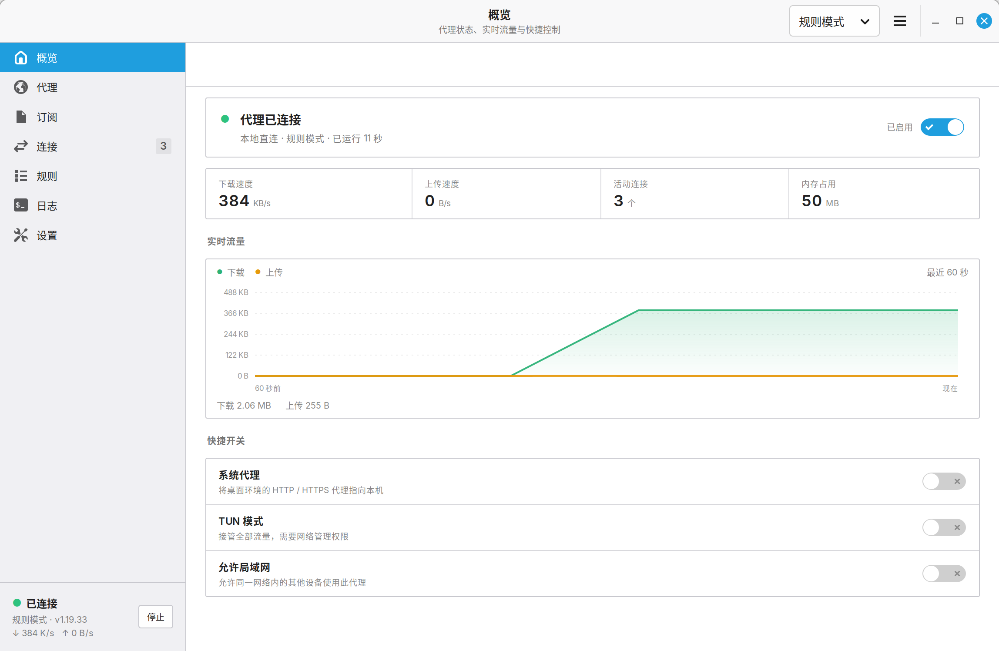
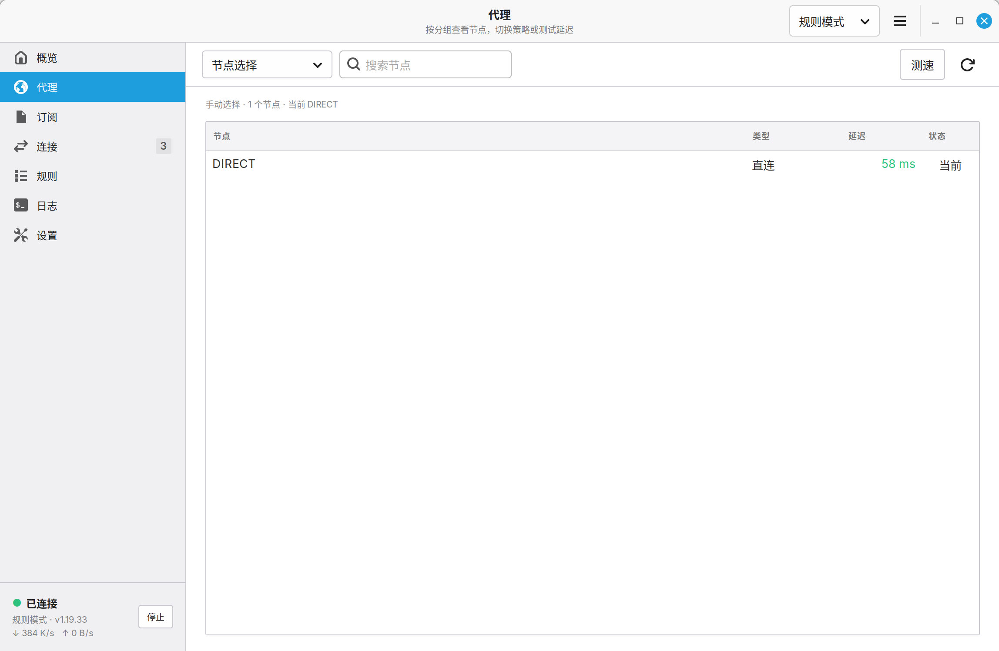
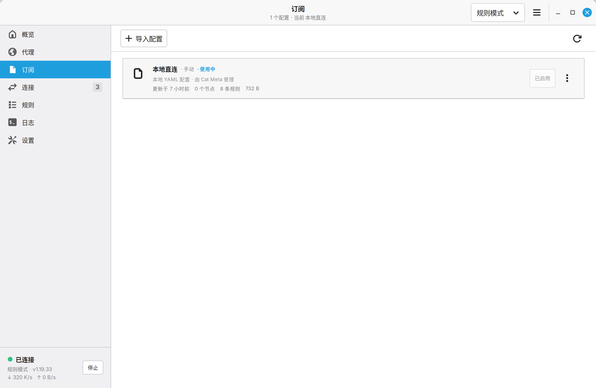
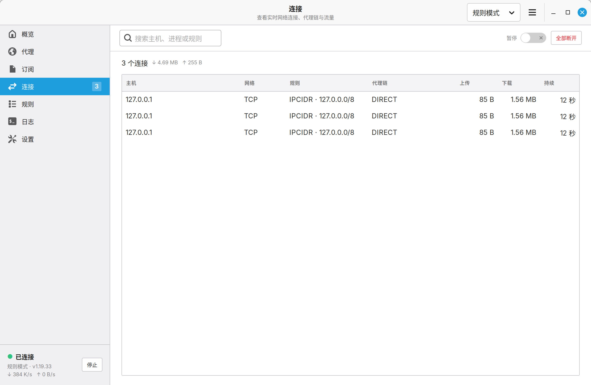
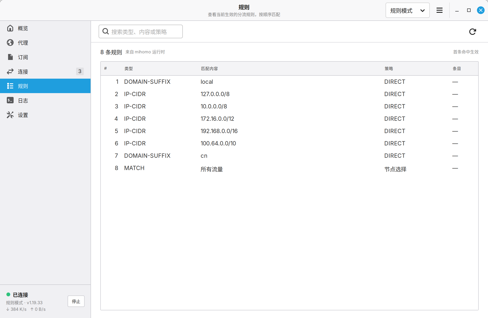
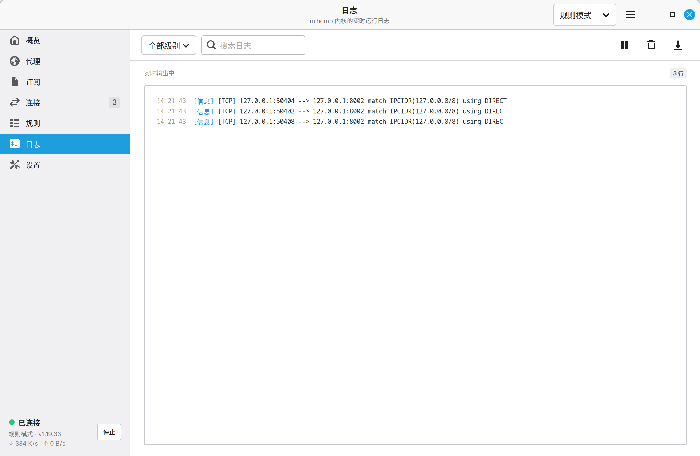
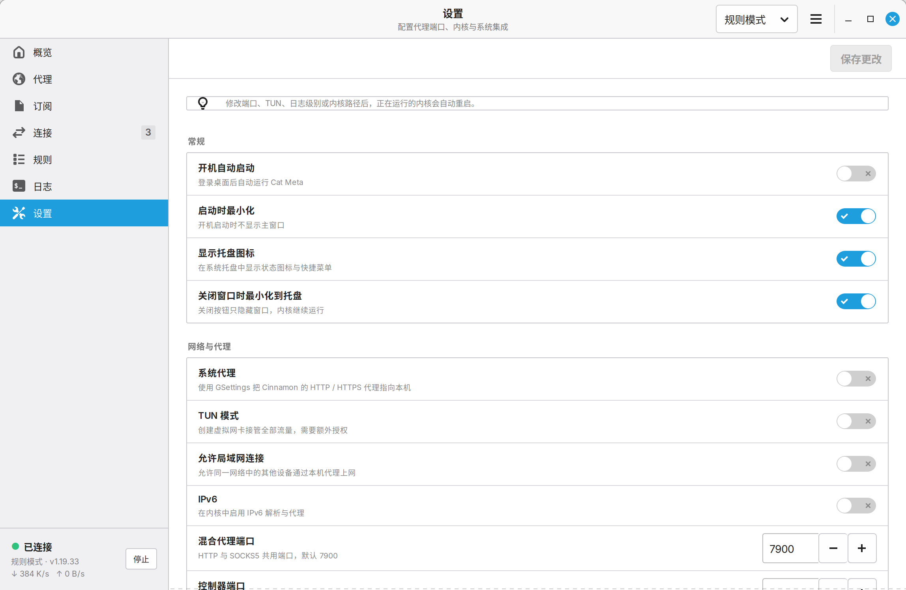
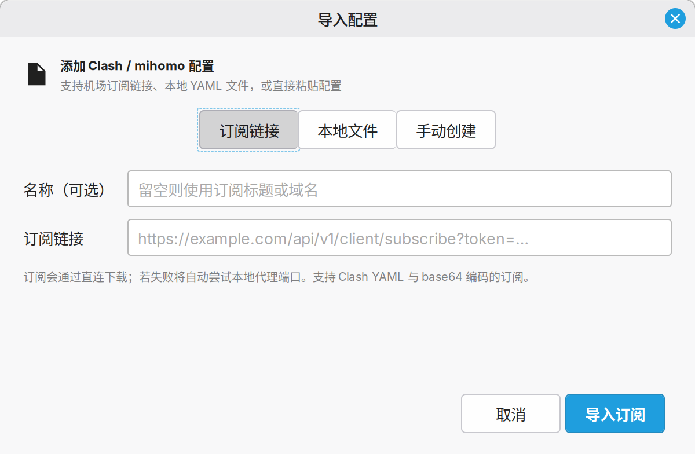

# Cat Meta


为 **Linux Mint** 打造的原生 **mihomo（Clash Meta）** 图形客户端。功能参考 Clash Verge Rev，但视觉与交互优先遵循 Linux Mint / XApp 原生规范：标题栏居中标题、满宽侧栏选中项、扁平分组、原生表格，不依赖 Electron，也不内置任何订阅或节点。

> [!IMPORTANT]
> **Cat Meta 只是一个本地图形界面**，不提供、不托管、不销售任何代理服务器、订阅、节点或网络接入服务，也不附带任何默认代理配置。请仅在所在国家或地区法律法规及所属网络政策允许的范围内使用，并自行承担使用风险。详见[免责声明与合规使用](#免责声明与合规使用)。



## 功能

- **概览**：连接状态、当前配置与节点、实时上传/下载曲线、会话流量、活动连接、内存占用、快捷开关；窗口隐藏到托盘时暂停当前节点轮询，重新显示时立即刷新。
- **代理**：按分组浏览节点，搜索、双击连接、右键测速、整组测速；状态列用勾选标记当前节点并位于开头，当前节点的“连接”按钮置灰；初次进入时当前节点居中显示；延迟仅在测试后显示，右键列标题可自定义列，并可启用带“连接 / 测试”按钮的操作列。
- **订阅**：导入远程订阅、本地 YAML 或手动创建；更新、编辑、重命名、导出、删除；编辑 YAML 默认使用内置编辑器，可在设置中关闭以改用系统默认编辑器（不可用时回退内置），保存后自动校验并重载；展示流量用量、到期时间与节点/规则数量。
- **连接**：实时连接列表，按主机/进程/规则/代理链搜索，查看详情、复制主机、关闭单条或全部连接。
- **规则**：展示运行时规则或订阅中的规则，支持搜索、复制与策略查看。
- **日志**：通过 WebSocket 实时接收 mihomo 日志，按级别与关键词过滤，暂停、清空、导出。
- **设置**：系统代理、TUN、局域网、IPv6、混合端口、控制器端口、日志级别、测速地址、Geo 数据、订阅自动更新、内置/系统编辑器选择、自启动、启动时自动启动内核、托盘行为。
- **系统集成**：XApp 托盘图标与快捷菜单、Cinnamon/GSettings 系统代理、开机自启动、桌面通知、单实例运行。托盘图标会安装到用户 hicolor 图标主题；左键显示主窗口，右键由 XApp 调用系统原生 GTK 菜单（显示、启动/停止、系统代理、TUN、模式、设置、退出）；仅当 XApp 的 secondary menu 不可用时才回退到自绘菜单。
- **内核管理**：自动发现或下载官方 mihomo，配置校验、进程监督、运行时配置生成、API 密钥保护、GeoIP/GeoSite 多源准备。
- **原生体验**：标题栏显示当前页面、说明、代理模式与主菜单；侧栏使用 Mint 风格的满宽高亮；内容区采用 System Monitor / System Administration 式的扁平分组、细边框、原生表格与下拉框；左下角状态区显示连接状态、模式、内核版本和实时流量。跟随系统字体、配色、高对比度与 HiDPI。

## 界面

| 代理 | 订阅 |
| --- | --- |
|  |  |

| 连接 | 规则 |
| --- | --- |
|  |  |

| 日志 | 设置 |
| --- | --- |
|  |  |

页面标题、状态与说明集中在标题栏；连接、规则与节点使用原生表格；代理分组使用下拉框切换；代理模式可从标题栏切换。界面不追求深色面板或网页式卡片，而是尽量贴近 Mint 自带的 System Monitor、System Administration 和文件管理器。

> 截图使用本地示例配置，不包含真实订阅或可连接的代理节点。



## 环境要求

- 主要目标：Linux Mint 21+ / LMDE，Cinnamon 桌面；MATE / GNOME 亦可
- 其他桌面：XFCE、LXQt 等可以运行，但有两处限制——
  - 系统代理：GNOME 系桌面写 `org.gnome.system.proxy`，立即生效；XFCE/LXQt 等没有
    统一的桌面代理设置，改为写入 `~/.config/environment.d/90-cat-meta-proxy.conf`
    的 `http_proxy` / `https_proxy` 等变量，重新登录后对所有应用生效（需要立即全局
    生效时用 TUN 模式）；
  - 托盘图标需要面板提供宿主：XFCE 需启用“通知区域”插件，LXQt 走 StatusNotifier。
    没有宿主时会自动禁用托盘，避免窗口最小化后找不到。
- Python 3.10+
- GTK 3.24、PyGObject
- 可选：XApp 1.0（Mint 上的托盘图标）、psutil（内核内存显示）、Requests（订阅/API 已随系统提供）

安装依赖（Debian / Ubuntu / Linux Mint）：

```bash
sudo apt install python3-gi gir1.2-gtk-3.0 python3-requests python3-psutil \
                 gir1.2-xapp-1.0 libcap2-bin
```

Fedora：

```bash
sudo dnf install python3-gobject gtk3 python3-requests python3-psutil \
                 xapp libcap
```

PyYAML 已作为纯 Python 代码内置在 `catmeta/vendor/yaml`，无需额外安装。

## 直接运行

```bash
cd cat-meta
./run.py
```

或：

```bash
python3 run.py
```

首次启动后：

1. 打开 **订阅 → 导入配置**，导入机场订阅或本地 Clash/mihomo YAML。
2. 打开 **设置 → 内核**，点击 **下载内核**（需要访问 GitHub；也可以手动选择已有的 mihomo 可执行文件）。
3. 回到 **概览** 启动代理。
4. 需要接管全部流量时，在 **设置 → 内核 → 授权 TUN** 完成系统授权。

## 安装

### 当前用户安装（无需 root）

```bash
./scripts/install.sh --user
cat-meta
```

安装位置：

- 程序：`~/.local/lib/cat-meta`
- 命令：`~/.local/bin/cat-meta`
- 桌面文件：`~/.local/share/applications/cat-meta.desktop`
- 图标：`~/.local/share/icons/hicolor/scalable/apps/`

请确保 `~/.local/bin` 在 `PATH` 中。

### 系统安装

```bash
sudo ./scripts/install.sh --system
```

程序安装到 `/usr/lib/cat-meta`，命令为 `/usr/bin/cat-meta`。卸载时删除相应安装目录与桌面/图标文件即可；用户数据不会被删除。

## TUN 模式

TUN 需要 `CAP_NET_ADMIN` 与 `CAP_NET_RAW`。Cat Meta 不会以 root 运行整个应用，而是只给 mihomo 内核授予能力：

```bash
./scripts/setup-tun.sh
# 或指定内核路径
./scripts/setup-tun.sh /path/to/mihomo
```

也可以在 **设置 → 内核 → TUN 权限** 点击 **授权 TUN**，通过 `pkexec` 弹出系统授权窗口。

注意：

- 每次替换 mihomo 二进制后能力会丢失，需要重新授权。
- TUN 会接管系统流量，请确认已配置可用的节点/规则后再开启。
- 不同内核对 `stack` 支持不同，默认使用 `mixed`，可在配置文件中覆盖。

## 系统代理

系统代理通过 GSettings 写入：

- `org.gnome.system.proxy mode=manual`
- HTTP / HTTPS / SOCKS 指向 `127.0.0.1:<混合端口>`

手动退出 Cat Meta（托盘退出、`Ctrl+Q`，或关闭“关闭到托盘”后关闭窗口）时，会先把系统代理恢复为 `mode=none`，避免代理仍指向已停止的内核而断网；`system_proxy` 偏好会保留，下次启动内核后自动重新启用。

目前主要面向 Cinnamon / GNOME 系桌面。KDE 或其他不使用 GSettings 的桌面不会修改系统代理，但仍可使用混合端口或 TUN。

## 数据目录

| 内容 | 路径 |
| --- | --- |
| 设置 | `~/.config/cat-meta/settings.json`（权限 0600） |
| 订阅索引 | `~/.config/cat-meta/profiles.json` |
| 订阅 YAML | `~/.local/share/cat-meta/profiles/` |
| 运行时配置 | `~/.local/share/cat-meta/runtime/config.yaml` |
| mihomo 内核 | `~/.local/share/cat-meta/bin/mihomo` |
| Geo 数据 | `~/.local/share/cat-meta/geoip.metadb`、`geosite.dat` |
| 日志 | `~/.local/share/cat-meta/logs/` |
| 应用缓存 | `~/.cache/cat-meta/` |

## 快捷键

| 快捷键 | 功能 |
| --- | --- |
| `Ctrl + 1…7` | 切换页面 |
| `Ctrl + R` | 重启内核 |
| `Ctrl + ,` | 打开设置 |
| `Ctrl + F` | 聚焦当前页面搜索 |
| `Ctrl + Shift + S` | 切换系统代理 |
| `Ctrl + Q` | 退出 |

## 工作原理

```text
cat-meta/
├── run.py                      启动器
├── catmeta/
│   ├── app.py                  Gtk.Application、单实例、CSS/图标
│   ├── controller.py           状态编排、事件总线、自动更新
│   ├── mihomo.py               内核发现/下载、配置生成、进程管理
│   ├── api.py                  mihomo REST 客户端
│   ├── ws.py                   零依赖 RFC 6455 WebSocket 客户端
│   ├── geodata.py              GeoIP/GeoSite 检测与多源下载
│   ├── profiles.py             订阅、本地配置、元数据
│   ├── settings.py             原子化 JSON 设置
│   ├── system.py               GSettings 系统代理、自启动、通知
│   ├── tray.py                 XApp 托盘与原生菜单
│   ├── ui/                     GTK 窗口、页面、组件、Cairo 图表
│   ├── assets/                 主题 CSS 与 SVG 图标
│   └── vendor/yaml/            内置 PyYAML
├── packaging/cat-meta.desktop
├── scripts/install.sh
├── scripts/setup-tun.sh
└── tests/
```

关键设计：

- **运行时配置生成**：以订阅 YAML 为基础，覆盖端口、模式、日志级别、控制器地址与 TUN；保留用户规则与代理组；写入 0600 权限文件后交给 mihomo。
- **进程监督**：mihomo 作为子进程运行并写入日志；应用退出、托盘退出或收到 SIGTERM/SIGINT 时清理进程。启动时会识别并结束上次会话遗留、仍使用本应用 `runtime/config.yaml` 的 mihomo，避免注销重新登录后端口被旧内核占用；内核意外退出会关闭系统代理并进入异常状态。
- **单实例**：通过 GApplication ID `com.github.catmeta.CatMeta` 保证只有一个实例；`cat-meta --page=settings` 会唤起已有窗口。
- **线程模型**：网络请求、内核启动、订阅更新在 worker 线程执行；所有 GTK 更新通过 `GLib.idle_add` 回到主线程。
- **安全**：控制器仅监听 `127.0.0.1`，自动生成 Bearer Secret；订阅和内核 API 请求不走系统代理（避免回环），需要时显式尝试本地代理端口。
- **原生外观**：只使用主题颜色变量和字体，不强制浅色/深色；侧栏选中项、分组边框与表格样式参考 Linux Mint 官方 XApp 应用；Cairo 图表使用系统前景色绘制网格与坐标。

## 测试

```bash
python3 -m unittest discover -s tests -v
```

测试覆盖配置生成、TUN/端口覆盖、订阅导入与更新、设置持久化、Geo 数据检测、格式化与延迟分类。

手动集成检查：

```bash
# 1. 启动应用并下载内核后，确认 API 可用
curl -H "Authorization: Bearer <secret>" http://127.0.0.1:19098/version

# 2. 通过混合端口访问
curl --proxy http://127.0.0.1:7900 https://www.gstatic.com/generate_204 -I
```

## 已知限制

- 仅支持 Linux / X11 与 Wayland（通过 GTK 3）；不提供 Windows/macOS 版本。
- 系统代理仅实现 GSettings 路径，KDE 等桌面请使用 TUN 或手动代理。
- TUN 需要额外授权；部分内核版本/发行版对 `stack` 或 `dns-hijack` 的支持不同。
- 订阅下载主要面向 Clash/mihomo YAML；base64 编码内容会尝试解码，不解析其他机场私有格式。
- 不与任何在线服务绑定，项目中不包含订阅、节点或第三方内核二进制。

## 免责声明与合规使用

Cat Meta 是 mihomo 的本地图形前端，仅用于管理用户自行选择、导入或部署的内核与配置。

**本项目不提供：**

- 任何代理服务器、订阅链接、节点、机场服务或网络接入服务；
- 任何默认代理配置、节点列表或绕过网络管理的说明；
- 对任何计算机系统或网络的访问授权。

**使用者责任：**

- 你应自行确认所在国家或地区的法律法规，以及你所属网络或组织的使用政策；仅在合法、合规且已获授权的范围内使用本项目。
- 你导入的订阅、节点与规则，以及通过这些配置访问的内容，均由你自行负责。
- 请勿将本项目用于未经授权访问、干扰或破坏他人计算机系统与网络，规避计费、审计或访问控制，侵害他人隐私与合法权益，传播违法内容，或从事其他违法活动。
- 不同法域对代理软件、加密通信与跨境网络访问的规定差异很大。若你不确定自己的使用方式是否合规，请先咨询专业意见或停止使用。
- 本项目不构成对任何使用行为的许可、鼓励或背书。

**无担保与责任限制：**

- 本项目按 GPL-3.0 第 15、16 条以“现状”提供，不附带任何明示或暗示的担保，包括但不限于适销性、特定用途适用性与不侵权担保。
- 在法律允许的最大范围内，作者与贡献者不对因使用或无法使用本项目而产生的任何直接、间接、附带或后果性损失承担责任。
- 本项目不收集遥测；订阅、节点、设置与日志均保存在本机，详见[数据目录](#数据目录)。

**第三方与商标：**

- mihomo 是独立项目，遵循 GPL-3.0，由用户自行下载安装；其行为、许可与合规性由该项目及使用者自行负责。
- Linux Mint、XApp、mihomo、Clash 等名称与商标归各自权利人所有；本项目与上述项目无隶属、赞助或背书关系。
- 请仅从本仓库或可信来源获取安装包；第三方重新打包的版本可能被修改。

若你不同意上述内容，请勿使用或分发本项目。

> **English (summary):** Cat Meta is a local GUI front-end for mihomo. It does not provide, host, or sell any proxy servers, subscriptions, nodes, or network access, and ships with no default proxy configuration. Use it only where permitted by applicable law and your network policy; you are solely responsible for your configuration and conduct. The software is provided “AS IS” under GPL-3.0, without warranty of any kind. The authors are not affiliated with or endorsed by the mihomo, Linux Mint, or XApp projects.

## 第三方组件

- [mihomo](https://github.com/MetaCubeX/mihomo) — GPL-3.0，运行时下载，不包含在源码中。
- [PyYAML](https://pyyaml.org/) — MIT，已内置，许可证见 [`catmeta/vendor/yaml/LICENSE`](catmeta/vendor/yaml/LICENSE)。
- [XApp](https://github.com/linuxmint/xapp) — LGPL-2.1，通过 GObject Introspection 使用。
- [MetaCubeX/meta-rules-dat](https://github.com/MetaCubeX/meta-rules-dat) — GeoIP/GeoSite 数据来源。

## 许可证

Cat Meta 以 **GPL-3.0** 发布，详见 [LICENSE](LICENSE)。

该许可仅适用于本仓库中的代码。mihomo 内核、PyYAML、XApp 及其他第三方组件分别遵循其自身许可证；GPL-3.0 不构成对任何第三方服务、订阅或网络接入的授权。
